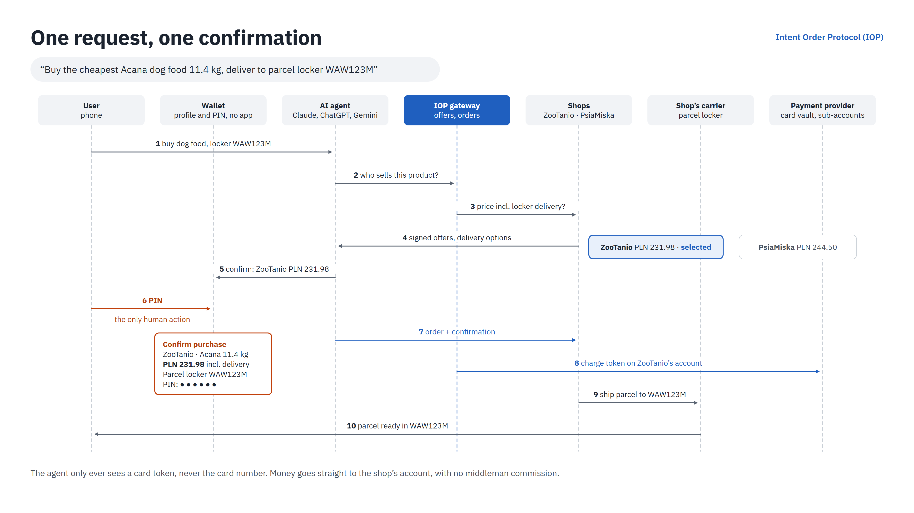

# Future Protocol

**Tell an AI agent what to buy and where to deliver it. The agent compares shops, pays and
arranges delivery itself. You confirm once, with a PIN.**

Working name of the protocol: **Intent Order Protocol (IOP)**.

## The problem

Most online shopping still happens by hand: search, compare, fill in forms, pay, pick a
delivery slot. Today's AI agents can only imitate this by clicking through websites, which
is slow and fragile, and it means handing them your card details.

## How it works

1. **You say:** "Buy the cheapest Acana dog food 11.4 kg, deliver to parcel locker WAW123M."
   What matters is the product and the delivery type and point. A date is optional.
2. **The agent asks participating shops** for signed offers, each with the delivery options
   the shop offers at checkout, and compares total prices including parcel-locker delivery.
3. **You get one confirmation** showing the shop, the exact product and the exact amount,
   and enter your PIN.
4. **The order is placed and paid.** It lands in the shop's own system already paid.
5. **The shop ships as usual** with its own carrier, and the parcel goes to your locker.

## Principles

| Principle | What it means |
|---|---|
| **One human action** | The only thing the agent cannot do is enter your PIN. No confirmation, no order and no payment |
| **The agent never sees your card** | Card details stay in the payment provider's vault. The agent only handles a token |
| **Money goes straight to the shop** | Payments are charged on the shop's own account at the payment provider. Nothing passes through us, and we take no commission |
| **The shop keeps its customer** | Orders arrive in the shop's existing system (e.g. Base, WooCommerce), not on a third-party platform |
| **No app to install** | Setup and confirmation happen on a web page |
| **Built on open standards** | Designed as an extension of Google's Universal Commerce Protocol (UCP) and Agent Payments Protocol (AP2), with agent access via the Model Context Protocol (MCP) |

## What IOP adds to existing standards

Existing agentic-commerce standards let an agent buy in **one shop it already knows**.
IOP adds two things:

- **Cross-shop offers:** one query to many shops, matched by product name, description and
  attributes (EAN when available), compared on total price including the chosen delivery
- **One wallet for many independent shops:** one saved card and one PIN confirmation,
  outside closed ecosystems

Delivery options, including parcel lockers, reuse UCP's existing fulfillment extension.

## Status

Concept and prototype in progress (October 2026). The first pilot targets online pet shops
in Poland.

The specification is not published yet.
